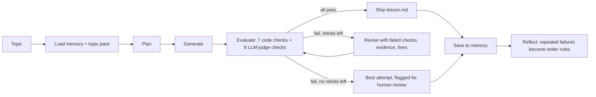
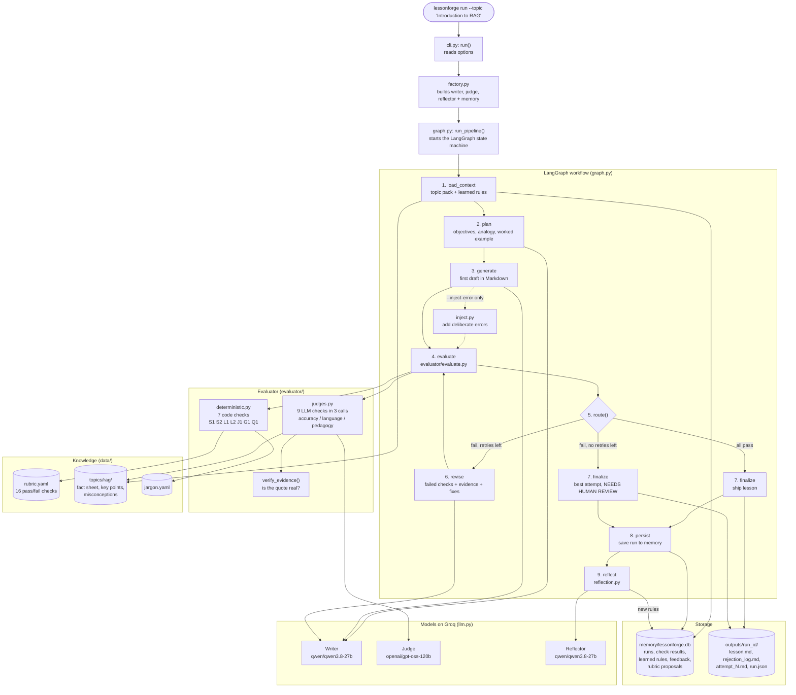

# LessonForge

**A self-evaluating lesson generator.** Give it a topic; it writes a beginner lesson, grades it against a
strict pass/fail rubric, and rewrites it using the reviewer's feedback until it passes (or flags it for a
human after 2 retries). It remembers what went wrong across runs and turns repeated failures into new rules
for the writer.

Built for: a 12th-grade graduate from India with limited English and no AI background.
Submission topic: **Introduction to RAG**.



## Architecture: what happens when you type `lessonforge run`



| Step | Node | File(s) | What happens |
|---|---|---|---|
| 0 | - | `cli.py`, `factory.py` | Reads command options and `.env`, then builds the writer, judge and reflector models and opens SQLite memory. |
| 1 | `load_context` | `knowledge.py`, `memory.py` | Finds `data/topics/rag/` (fact sheet, 10 key points, 7 misconceptions) and loads the active learned rules from memory. |
| 2 | `plan` | `prompts.py` | The writer chooses learning goals, an everyday Indian analogy and a worked-example scenario, returned as JSON. |
| 3 | `generate` | `prompts.py`, `lesson_format.py` | The writer drafts the lesson with the required 8 sections, the writing rules, the fact sheet and the learned rules. With `--inject-error`, `inject.py` corrupts this draft. |
| 4 | `evaluate` | `evaluator/*` | 7 code checks run instantly, then 9 LLM checks in 3 judge calls. Every verdict has a reason, an evidence quote (verified to exist in the lesson) and a fix. |
| 5 | `route` | `graph.py` | All pass: finalize. Fail with retries left: revise. Fail with no retries left (default `MAX_RETRIES=2`): finalize anyway. **The loop always ends.** |
| 6 | `revise` | `prompts.py` | The writer rewrites the full lesson, given each failed check's ID, reason, evidence and fix, plus the checks it must not break again. It adds a change log, and the lesson goes back to step 4. |
| 7 | `finalize` | `render.py` | Writes `lesson.md` (the passing lesson, or the best attempt marked NEEDS HUMAN REVIEW), `rejection_log.md`, each attempt and `run.json`. |
| 8 | `persist` | `memory.py` | Saves the run, every attempt and every check result to SQLite. |
| 9 | `reflect` | `reflection.py` | If a check has failed in 2 or more separate runs, the reflector writes a new writer rule, which is used in every later run. Human feedback can become rubric proposals, which need human approval. |

## Setup

Requires Python 3.10+ and a free [Groq API key](https://console.groq.com/keys).

```powershell
cd lessonforge
python -m venv .venv
.\.venv\Scripts\activate          # macOS/Linux: source .venv/bin/activate
pip install -e ".[dev]"
copy .env.example .env            # macOS/Linux: cp .env.example .env
# then open .env and set GROQ_API_KEY
```

## Run

```powershell
# Full loop: generate -> evaluate -> regenerate -> lesson + rejection log
lessonforge run --topic "Introduction to RAG"

# Demo: corrupt attempt 1 on purpose (false claim, undefined jargon, 50-word sentence)
lessonforge run --inject-error all

# Evaluate any lesson file (exit code 1 if it fails)
lessonforge evaluate outputs/latest/lesson.md
lessonforge evaluate outputs/latest/lesson.md --inject factual,jargon   # catch deliberate errors
lessonforge evaluate tests/fixtures/good_lesson.md --code-only           # no API key needed

# Visual walkthrough (attempts, failed checks, diffs, memory)
streamlit run app.py
```

Each run writes to `outputs/<run_id>/` (and copies it to `outputs/latest/`):

| File | Contents |
|---|---|
| `lesson.md` | The passing lesson (or the best attempt, marked NEEDS HUMAN REVIEW) |
| `rejection_log.md` | Every attempt: what failed, why, evidence quote, fix requested, what the writer changed |
| `attempt_N.md` | Each attempt's full text |
| `run.json` | Everything above in machine-readable form |

### Example outputs (real runs, committed)

| Run | What it shows |
|---|---|
| [`examples/final_lesson_run/`](examples/final_lesson_run/) | The submitted lesson. Failed J1 and C1, then L3, and passed all 16 checks on attempt 3. |
| [`examples/error_injection_demo_run/`](examples/error_injection_demo_run/) | Errors were injected into attempt 1 on purpose. The evaluator caught them all: A1/A2 (false claim), J1/J2 (jargon), L2 (long sentence). The writer fixed most; after 2 retries the run stopped and flagged the best attempt for human review. |

Memory in action: after the 2nd normal run, reflection saw J1 fail in two separate runs and learned the
rule *"Before using any technical term, ensure it is explicitly defined in the glossary section of the
lesson."* Later runs add this rule to the writer prompt (see "Learned rules used in this run" in the demo
log).

### Memory and learning commands

```powershell
lessonforge memory                       # run history, pass rate per check, learned rules
lessonforge feedback <run_id> "The example has too many numbers for a beginner"
lessonforge reflect                      # learn now instead of waiting for the next run
lessonforge rubric list                  # rubric changes suggested from human feedback
lessonforge rubric approve <id>          # becomes check X<id> in every future evaluation
lessonforge rules list | disable <id> | enable <id>
lessonforge run --no-rules               # baseline run without learned rules, for comparison
lessonforge graph                        # print the LangGraph workflow as Mermaid
```

## The rubric (16 hard pass/fail checks)

| ID | Check | How | Dimension |
|---|---|---|---|
| S1 | All 8 sections present, in teaching order | code | coherent flow |
| S2 | 800-1800 words | code | covers key points |
| L1 | Flesch-Kincaid grade ≤ 8 | code | beginner-friendly |
| L2 | Avg sentence ≤ 18 words, none > 30 | code | beginner-friendly |
| J1 | Every technical term used is in the glossary | code | no unexplained jargon |
| G1 | Every glossary entry has a Hindi meaning | code | beginner-friendly |
| Q1 | Quiz has ≥ 3 questions and an answer key | code | coherent flow |
| A1 | Every claim agrees with the RAG fact sheet | LLM (accuracy) | accurate & grounded |
| A2 | No listed misconception (e.g. "RAG retrains the model") | LLM (accuracy) | accurate & grounded |
| J2 | Each term explained in simple words at first use | LLM (language) | no unexplained jargon |
| L3 | Everyday words, no idioms or unfamiliar cultural references | LLM (language) | beginner-friendly |
| C1 | All 10 key points taught | LLM (pedagogy) | covers key points |
| E1 | An analogy plus a full worked example with concrete data | LLM (pedagogy) | teaches by example |
| E2 | Examples familiar to an Indian learner | LLM (pedagogy) | teaches by example |
| F1 | What → why → how → example; standalone | LLM (pedagogy) | coherent flow |
| Q2 | Quiz answers correct and answerable from the lesson | LLM (pedagogy) | coherent flow |

The rubric lives in [`data/rubric.yaml`](data/rubric.yaml). The ground truth for accuracy lives in
[`data/topics/rag/`](data/topics/rag/). See [`docs/DESIGN.md`](docs/DESIGN.md) for the reasoning
behind every choice.

## Project layout

```
lessonforge/
  app.py                      Streamlit viewer
  data/
    rubric.yaml               the checks, thresholds and judge criteria
    jargon.yaml               technical terms that must be glossed
    topics/rag/               topic pack: fact_sheet.md, key points, misconceptions
  src/lessonforge/
    graph.py                  LangGraph workflow (nodes + routing)
    prompts.py                every prompt in one file
    lesson_format.py          required lesson structure (shared by writer and checks)
    evaluator/                deterministic.py (code checks), judges.py (LLM judges)
    memory.py                 SQLite: runs, check results, rules, feedback, proposals
    reflection.py             self-evolving step
    inject.py                 deliberate error injection
    llm.py                    Groq client, token budget, JSON validation and repair
    cli.py                    command-line interface
  tests/                      offline tests (scripted fake models, no API key)
```

## Tests

```powershell
pytest
```

All tests run offline with scripted fake models. They cover: each code check catching its error, the
fail-then-fix loop, the loop terminating and flagging for review, memory learning a rule from repeated
failures and using it in the next run, human feedback becoming an approved rubric check, and the
Streamlit viewer rendering a run.

## Adding a new topic

Copy `data/topics/rag/` to `data/topics/<name>/` and edit `topic.yaml` and `fact_sheet.md`. Topics
without a pack still run, in "ungrounded" mode: the planner proposes key points and the accuracy judge
relies on its own knowledge. This is clearly logged.
