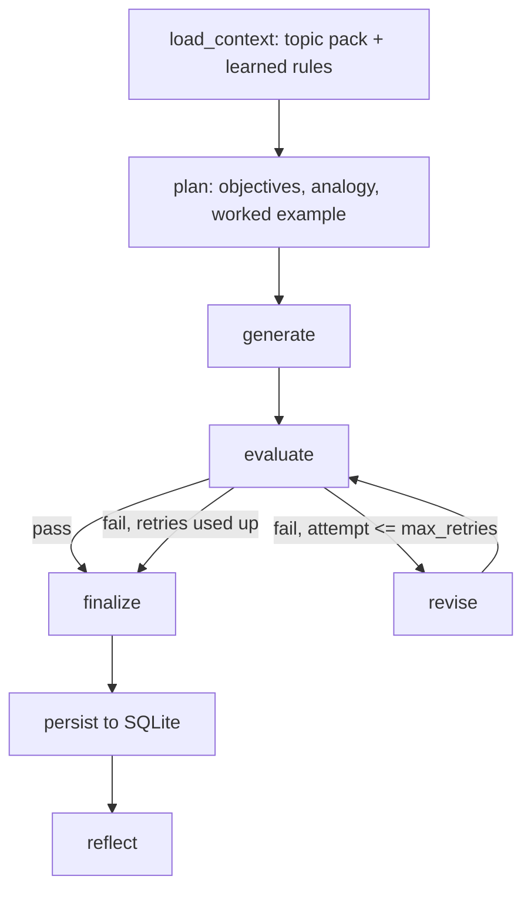

# LessonForge: design and trade-offs

## 1. The problem, restated

The job is not to write one good prompt. It is to build a system that decides, without a human,
whether a lesson is good enough to ship, and that improves itself when it is not. So the design centres
on the **evaluator** and the **feedback loop**, not on the generator.

The learner shapes every threshold: a 12th-grade graduate from India, educated in a non-English medium,
with limited English vocabulary and zero AI background.

## 2. Architecture

**Why LangGraph.** The process is a state machine with a cycle and a conditional exit. LangGraph makes that
explicit: each node is a pure function of the state, the routing rule is one function (`route` in
`graph.py`), and the termination guarantee is visible in code. With n8n, the logic would be harder to
version, test and review in a pull request.

**Why a planning node.** Choosing the analogy and the worked-example scenario before writing gives the
writer a fixed teaching plan. The plan is also saved in `run.json`, so a reviewer can see what was
intended.

**Why a topic pack (fact sheet, key points, misconceptions).** An LLM judge asked "is this accurate?"
tends to agree with fluent text. Giving the judge a curated **fact sheet** and an explicit
**misconceptions list** turns accuracy into a checkable comparison. The **key points** list is fixed by a
human, not invented by the writer, so the writer cannot quietly define success for itself. Topics without
a pack still run, but are logged as *ungrounded*.

## 3. The evaluator

### Hybrid: code checks first, LLM judges for judgment calls

| Use code when... | Use an LLM judge when... |
|---|---|
| the property is measurable (structure, sentence length, reading level, glossary format, quiz format, jargon list) | it needs understanding (accuracy, misconceptions, whether an explanation really explains, flow, cultural fit) |

Code checks give the same verdict every time, cost nothing, and cannot be talked into passing. They also
produce **precise fixes** ("split these 2 sentences: ...", "add glossary entries for: HNSW, BM25"), which
makes regeneration targeted.

### Hard pass/fail, no partial credit

Scores like 7/10 invite averaging away serious problems: a lesson with one false claim should not ship
because its language is excellent. Every check is binary, and the lesson ships only if **all** pass.
Severity (`critical` vs `major`) is used only to pick the best failed attempt to hand to a human.

### Judge design

- **Different model family from the writer.** The writer is Qwen 3.8 27B; the judge is GPT-OSS 120B
  (both on Groq). This reduces the bias of a model grading text in its own style.
- **Grouped by needed context.** Nine LLM checks run as three judge calls: *accuracy* (needs the fact
  sheet), *language*, and *pedagogy* (needs the key points). One call per check would use about three
  times the tokens and hit Groq's free-tier tokens-per-minute limit, with little gain in quality. One call
  for all checks would mix too much context and make results less reliable. Each check still gets its own
  verdict.
- **Temperature 0 and "when in doubt, FAIL".** A false fail costs one retry; a false pass ships a bad
  lesson to a learner.
- **Evidence quotes are verified.** Every verdict must quote the lesson. Code checks that the quote really
  exists (`verify_evidence`). A failure whose quote is not found is flagged "quote not found verbatim" in
  the log, so a hallucinated criticism is visible instead of silently steering a rewrite.
- **Structured output with repair.** Judge replies are validated against a Pydantic schema. Invalid JSON
  gets one repair round. A missing verdict is asked for again, then counted as a FAIL rather than ignored.

## 4. The regenerate step

- The writer receives each failed check's **ID, reason, evidence quote and fix**, plus the fact sheet and
  key points again.
- **No regressions:** the prompt lists checks that failed earlier and were fixed, and tells the writer not
  to break them again. The rejection log records *fixed / newly broken / still failing* for each attempt.
- **Full rewrite instead of section patches.** Patching single sections is cheaper but often breaks flow
  between sections (F1). The writer outputs the full lesson, with an instruction to keep what already works.
- The writer adds a **change log** after a `<<<CHANGES>>>` marker. It goes into the rejection log as "what I
  changed on retry".
- **Termination:** at most `MAX_RETRIES` (default 2) revisions, so at most 3 attempts. If none pass, the
  attempt with the fewest critical failures (then fewest failures overall) is saved and clearly marked
  **NEEDS HUMAN REVIEW**. A failing lesson is never shipped silently.

## 5. Memory and self-evolution

SQLite file `memory/lessonforge.db`, with these tables: `runs`, `attempts`, `check_results`,
`learned_rules`, `human_feedback`, `rubric_proposals`.

**Learning loop (the `reflect` node, run after every run):**

1. Find checks that failed in **2 or more different runs**. One bad sample is noise; a repeated failure is
   a pattern. Runs with deliberately injected errors are excluded, so demos don't teach the system wrong
   lessons.
2. A reflector model turns each repeated failure into one short, concrete rule for the writer (for
   example, "Before using 'embedding', explain it as a list of numbers that captures meaning").
3. Active rules are added to the writer's prompt in every later run, under "LESSONS LEARNED FROM PAST
   REVIEWS". The system tracks how many times each rule was applied, and `lessonforge memory` shows
   first-attempt failures over time to measure whether the rules help.

**Guardrails:**

- **Prompts evolve automatically; the rubric does not.** The system can make its writer stricter on its
  own, but it can never make its exam easier. Human feedback (`lessonforge feedback`) can produce
  **rubric proposals**, which become new checks (`X<id>`) only after a human approves them.
- Rules are stored as rows that can be disabled (`lessonforge rules disable`), and active rules are capped
  at 12, so the prompt doesn't grow forever.
- `lessonforge run --no-rules` gives a baseline run without learned rules, for comparison.

## 6. Making the target audience concrete

| Need | How it is enforced |
|---|---|
| Limited English | L1 reading grade ≤ 8, L2 short sentences, L3 no idioms or difficult words |
| Non-English-medium background | G1: every glossary term has a Hindi meaning in Devanagari |
| Zero background | J1 and J2: every technical term glossed and explained at first use; F1 standalone |
| Indian context | E2: examples from school, board exams, cricket, trains, shops |
| AI-career motivation | The "why it matters" section and real-world uses (key point KP10) |

Hindi text is removed before the readability checks, so it does not distort the scores.

## 7. Trade-offs and known limits

- **Readability formulas are rough.** Flesch-Kincaid counts syllables and sentence length, not real
  difficulty. That is why it is paired with the L3 LLM check.
- **An LLM judge can be wrong.** This is reduced by the fact sheet, verified quotes, a different model
  family, and the tests, but not eliminated. That is why every failed attempt is logged with evidence for
  human audit.
- **Glossary matching is lenient.** For example, a "Vector database" entry also covers the word "vector".
  That is acceptable, because J2 separately checks that each term is explained in the body.
- **Groq free-tier limits.** A client-side token budget waits *before* sending requests instead of
  wasting retries on rate-limit errors. A full run takes a few minutes on the free tier.
- **Full rewrites cost more tokens** than section patches. This was chosen for coherence.

## 8. How it is tested

`pytest` runs offline using scripted fake models:

- Each code check catches its target error (injected jargon, long sentences, missing section, missing
  Hindi meaning, missing answer key, difficult vocabulary, too-short text).
- The loop fails, revises, then passes, and writes a correct rejection log.
- The loop always stops: a judge that always fails leads to 3 attempts and NEEDS HUMAN REVIEW.
- Memory learns a rule after repeated failures, and the next run's writer prompt contains it.
- Human feedback creates a proposal; once approved, it shows up as a new judge check.
- The Streamlit viewer renders a run without errors.
